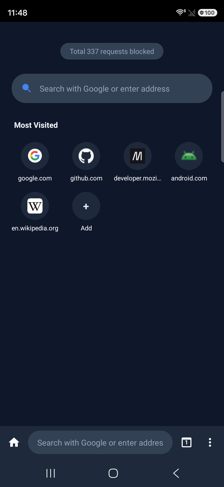
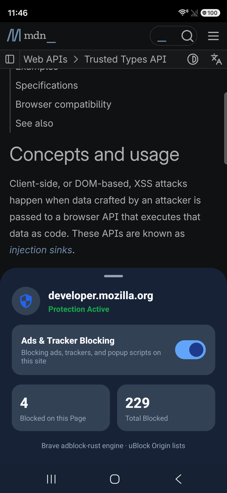
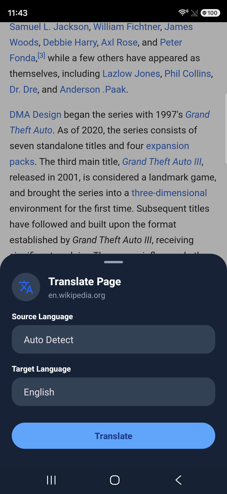
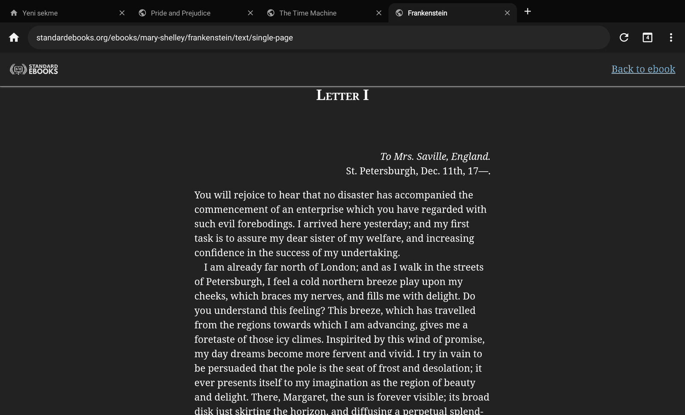

# 🚀 Orbit Browser

**A high-performance, ultra-lightweight Android web browser built on Android System WebView, featuring an embedded Brave `adblock-rust` C++/Rust engine, uBlock Origin filter lists, multi-language page translation, and Material Design 3 UI.**

Designed to run smoothly on devices with 1 GB RAM and fully compatible with newer Android versions.

---

## 📸 Screenshots

| Start page | Shield | Translate |
| :---: | :---: | :---: |
|  |  |  |
| Most Visited tiles carry each site's favicon, and the **Add** tile lets you pin your own shortcuts. The pill above shows how many requests have been blocked so far. | Per-site protection toggle, with counts for the current page and for the lifetime of the install, served by the Brave `adblock-rust` engine. | Source language is auto-detected and the target language is yours to pick; the page keeps its layout and links. |

### Tablet



Galaxy Tab Pro 8.4 (SM-T320), landscape, dark theme. Tablets get a tab strip above the
address bar, with the **+** button right after the last tab. The open page is
*Frankenstein* from [Standard Ebooks](https://standardebooks.org), released into the public
domain.

---

## 🆕 What's new in 2.7

- **Tablet tab strip** — on screens 600 dp and wider, tabs sit above the address bar as
  in Samsung Internet, with favicons and a close button on each; the **+** follows the last
  tab, and the strip scrolls when tabs no longer fit. Long-press **+** for a private tab.
  The ⋮ menu opens right under its button, and Settings and About keep a readable width.
- **In-page translation** — pages are translated where they are instead of through
  Google's `translate.goog` proxy, so sites that refuse that proxy (Wikipedia among them)
  translate too. Links stay in the right place in the sentence, only the part on screen
  is translated, and **Show original** puts the page back. The old proxy is still one tap
  away.
- **Private tabs are really private** — on WebView 123 and newer, private tabs get their
  own WebView profile: cookies, storage and cache are not shared with normal tabs and are
  wiped when the last private tab closes.
- **True black dark theme** — the dark theme is now black with neutral greys instead of
  navy.
- **Ad blocking engine** — Brave `adblock-rust` 0.13.6 adds `$to=` rules. The engine cache
  is now memory-mapped instead of copied: about 12 MB less memory the system cannot
  reclaim, measured on a 1 GB phone.
- **Stability on low-memory devices** — when the system kills a page's renderer to free
  memory, the browser no longer goes down with it; the page reloads. Pages are paused in
  the background when nothing is playing, and filter list text no longer passes through
  the Java heap during the engine compile (peak 68 → 13 MB).
- **Android 5–6 fixes** — the Translate sheet no longer crashes there, and a page that
  fails its certificate check now says so instead of staying blank.
- **About** links to the source code on GitHub.

Full changelog, in Russian and English: [CHANGES.md](CHANGES.md) —
[releases](https://github.com/egeeuzun/orbit/releases).

---

## ✨ Features

### 🛡️ 1. Ad Blocking
- **Embedded C++/Rust JNI Engine:** Powered by Brave Software's `adblock-rust` crate executing directly at native speed.
- **30 Filter Lists:** uBlock Origin core, badware and privacy lists, EasyList and EasyPrivacy, AdGuard Base, Tracking, Mobile, Annoyances and Social, Fanboy's lists, cookie-notice lists, and per-language lists for Turkish, Russian, German, French, Spanish/Portuguese, Japanese, Dutch, Italian, Chinese, Polish, Indonesian and Korean. The global core plus Turkish and Russian are enabled by default; the rest are one tap away in Settings.
- **Cosmetic Filtering:** Ad slots that survive network blocking are hidden by a document-start script, with optional generic filters.
- **Live Blocking Stats:** The Shield item in the menu opens a bottom sheet showing blocked counts for the current page and for the lifetime of the install.
- **Per-Site Protection Toggle:** Easily toggle adblocking ON/OFF for any website with a single tap (per-site allowlist).
- **Popup Blocking:** `window.open` calls to domains the engine flags as popups are consumed instead of opening a window, with a short toast in their place.

### 🌐 2. Multi-Language Web Page Translation
- **In-Page Translation:** Tap "Translate Page" from the overflow menu. The page stays where it is; only its text goes to Google's translation service and comes back into the page, so sites that block Google's translation proxy (such as Wikipedia) still translate.
- **Layout and Links Kept:** Paragraphs are rebuilt in the translated word order, with the original links and inline elements moved into place rather than copied. Addresses, domains and e-mail addresses are left untranslated.
- **Only What You Read:** Text on screen is translated first and the rest follows as you scroll, so memory use stays at the size of the visible text.
- **Show Original** restores the page, and **Open in Google Translate** is still there as a fallback.
- **Languages:** The source is taken from the page's declared language (or auto-detected); the target remembers your last choice and otherwise follows the system language (English, Turkish, German, French, Spanish, Russian, Arabic, Japanese, Chinese, Korean, Hindi and more).

### 🏠 3. Editable Start Page
- **Most Visited grid** built from your history, with each site's favicon on the tile.
- **Your own shortcuts:** the "+ Add" tile opens a small form (name optional, address required); long-press a shortcut you added to edit or remove it.
- **Remove what you do not want:** long-press a shortcut that came from history to drop it from the grid. Your history is kept and the site stays gone even after you visit it again.
- **Reset home shortcuts** in Settings → Appearance brings everything back.
- The grid widens with the screen: 4 columns on phones, 6 on wide screens, 8 on large tablets.

### 📐 4. Phone, Tablet, Foldable and Landscape Layouts
- **Tablet tab strip:** with the address bar on top on a 600 dp+ screen, tabs appear above it with favicons, a close button and a **+** right after the last tab; long-press **+** for a private tab. Tabs shrink to fit and scroll when they no longer do, and the strip follows rotation.
- **Menu under its button:** with the address bar on top, the ⋮ menu drops down from the button instead of rising from the bottom of the screen.
- **Readable width:** Settings and About are capped at 720 dp and centred on wide screens.
- **Address bar position** is a setting: Automatic (top on tablets, bottom on phones), Always top, or Always bottom.
- Touch targets, address bar height and text size grow on wide screens.
- Bottom sheets open fully expanded instead of a short peek you have to drag open.
- Edge-to-edge layout with proper insets for the status bar, camera cutout, navigation bar and keyboard; insets are frozen during fullscreen video so the page does not jump.

### 🔊 5. Background Media Playback
- Radio and video **keep playing when you leave the browser**.
- A foreground notification with **Play / Pause / Stop** keeps the process alive, and a `MediaSession` wires up lock-screen controls plus headset and Bluetooth buttons.
- The notification only appears when a page is actually playing audible sound, and Stop really stops playback.

### 🔍 6. Dynamic Search Engine & Real-Time Suggestions
- Google is set as default (switchable to DuckDuckGo, Bing, Yandex, Brave, Startpage).
- Dynamic search bar hint automatically updates to reflect the chosen engine (*"Search with Google or type URL"*).
- Optional real-time OpenSearch autocompletion in Settings; local history results appear immediately while online suggestions arrive separately.

### 🌙 7. Full Material 3 Light/Dark Theme & Web Darkening
- Complete Material Design 3 Day/Night theme with synchronized status bar and navigation bar icon colors, applied consistently to sheets, dialogs and every screen.
- **True black dark theme:** black background with neutral grey surfaces, no blue tint on raised surfaces; black pixels stay off on AMOLED screens.
- **Independent Web Darkening:** Web pages are NOT forcibly darkened just because Dark Theme is on. Web darkening ("Darken sites") is an independent option in Settings > Appearance, and pages keep a white base until you turn it on.

### 🖨️ 8. Printing
- Print the current page or save it as a PDF from the overflow menu, through the system print dialog.

### 📌 9. Optional Tab Session Restore
- *"Restore open tabs"* setting under Settings > General automatically restores tabs and URLs when reopening the app (Disabled by default).

### 📱 10. Webapp Mode & Home-Screen Shortcuts
- Pin any site to the home screen through the system dialog (`requestPinShortcut`); the shortcut icon is the site favicon, cached per host.
- The site opens as a fullscreen window with no address bar or toolbars, in its own task, so it multitasks as a separate app. Re-tapping the shortcut returns to the same window.
- Ad blocking, popup blocking and downloads all work inside a webapp window.

### ⬇️ 11. Downloads
- Files go through the system DownloadManager into the Downloads folder, with a progress notification, in both the browser and webapp mode.
- Handles APK links served without a `Content-Disposition` header.

### 🕶️ 12. Private Tabs
- Private tabs keep no history and no cache.
- On WebView 123 and newer each private session gets its own WebView profile, so cookies, local storage, IndexedDB and service workers are not shared with normal tabs. Everything is wiped when the last private tab closes, and leftovers are deleted at the next launch.
- On older WebView versions cookies are still shared with normal tabs, and Orbit says so when you open a private tab.

---

## ⚡ Memory & Performance

Measured on a 1 GB-class Android phone, release build:

| State | RAM |
| :--- | ---: |
| Start page, idle | ~30 MB |
| One page open | ~65–90 MB |
| Three tabs open | ~180 MB |

Cold start takes well under a second. Memory runs higher for a few seconds right after
launch while the filter engine is built, then settles.

- **Single Live WebView Architecture:** Only one WebView is kept alive by default.
  Background tabs are serialized with `saveState()` and their WebView destroyed, so the
  renderer memory comes back; they are restored when selected.
- **Compiled Engine Binary (`engine.bin`):** Filter rules are compiled once into a
  binary cache, so cold start does not pay for parsing them again.
- **Host Fast Path (`hosts.bin`):** A sorted host table answers most block decisions
  without crossing into the engine, and it is ready long before the full engine is.
- **Off-Main-Thread Everything:** SQLite, WebView provider warm-up, favicon writes and
  search suggestions all run off the main thread.
- **Memory-Mapped Engine:** `engine.bin` is used straight from a read-only memory map instead
  of being copied into the heap, so the kernel can drop its pages under pressure and only
  the part matching actually touches stays resident (about 5 of 12 MB while browsing).
  Filter lists are read by the native side, never by the Java heap.
- **Renderer Crash Recovery:** If the system kills the WebView renderer, the tab is kept
  and its page reloaded instead of the whole browser going down with it.
- **Background Pause:** When Orbit goes to the background with nothing playing, the page
  and its timers are paused.
- **Memory Pressure Handling:** When the system asks for memory, background tabs are put
  to sleep, the ad blocker's decision cache and the favicon cache are released, and under
  critical pressure sleeping tabs drop their back/forward state and keep only their address.

---

## 🤝 Contributors

- [@timcho968](https://github.com/timcho968) — webapp mode, downloads, popup blocking, Russian
  filter lists, the Jelly-style interface, and the privacy and signing work that went into 2.0.0
  ([#2](https://github.com/egeeuzun/orbit/pull/2)).

Bug reports and pull requests are welcome.

---

## 📜 Licenses & Open Source

Orbit Browser is open-source software distributed under the terms of the **Mozilla Public License 2.0 (MPL 2.0)**.

### Open Source Libraries & Components:
- **Orbit Browser:** Mozilla Public License 2.0 (MPL 2.0)
- **Brave adblock-rust Engine:** Mozilla Public License 2.0 (MPL 2.0) — Native C++/Rust adblock JNI engine by Brave Software.
- **uBlock Origin Filter Lists:** GNU General Public License v3.0 (GPLv3) — Community filter lists by Raymond Hill (gorhill) & contributors.
- **AndroidX & Jetpack Libraries:** Apache License 2.0 — Core-KTX, AppCompat, RecyclerView, WebKit, Lifecycle.
- **Google Material Components:** Apache License 2.0 — Material Design 3 UI components & BottomSheet dialogs.
- **Kotlin Standard Library:** Apache License 2.0 — Language runtime & tools by JetBrains.
- **GitHub Octicons:** MIT License — the GitHub mark on the About screen.

---

## 🛠 Building & Running

Clone the repository and build using Android Studio or terminal:

```bash
./gradlew assembleRelease
```

To re-compile the native `.so` adblock JNI engine from Rust sources (optional):

```bash
rustup target add aarch64-linux-android armv7-linux-androideabi x86_64-linux-android
cargo install cargo-ndk
export ANDROID_NDK_HOME=$ANDROID_HOME/ndk/27.2.12479018
./gradlew buildNativeAdblock
```

The `adblock` crate is built from a patched copy in `rust/adblock-jni/vendor/adblock` so the
engine cache can be memory-mapped. The changes are marked `ORBIT PATCH`; when updating the
crate, copy the new release there, re-apply them, and check the result with:

```bash
cd rust/adblock-jni && cargo run --release --example mmapcheck -- <filter-list-dir>
```

---

## 📁 Project Structure

```
app/src/main/
  java/com/orbit/browser/
    adblock/     AdblockService (downloading, compilation, decision cache), filter list
                 catalog, host blocklist, JNI wrapper (NativeAdblock)
    browser/     OrbitWebView (touch focus & scroll listener), WebView clients, tab
                 management, DownloadHelper, FaviconStore, cosmetic filtering bridge,
                 PageTranslator (in-page translation), IncognitoProfiles
    data/        Preferences (Prefs), Search Suggestions, SQLite DB, browsing data
    ui/          MainActivity, WebappActivity, SettingsActivity, ShieldSheet, MenuSheet,
                 TabsSheet, TabStrip (tablet), TranslateSheet, HomeView, ListActivity,
                 AboutActivity
    util/        URL helpers
  assets/        orbit_cosmetic.js, orbit_translate.js (in-page translation, ES5 for
                 Android 5's WebView)
  res/
    layout/      activity_main.xml, activity_main_top.xml, activity_settings.xml, activity_list.xml,
                 dialog_shield.xml, dialog_translate.xml, view_home.xml
    values/      strings.xml (English default), themes.xml, colors.xml
    values-night/ dark palette (colors.xml, bools.xml)
    values-tr/   strings.xml (Turkish)
rust/adblock-jni/ JNI bridge for Brave adblock-rust engine
  vendor/adblock/  patched adblock-rust (memory-mapped engine cache)
```
