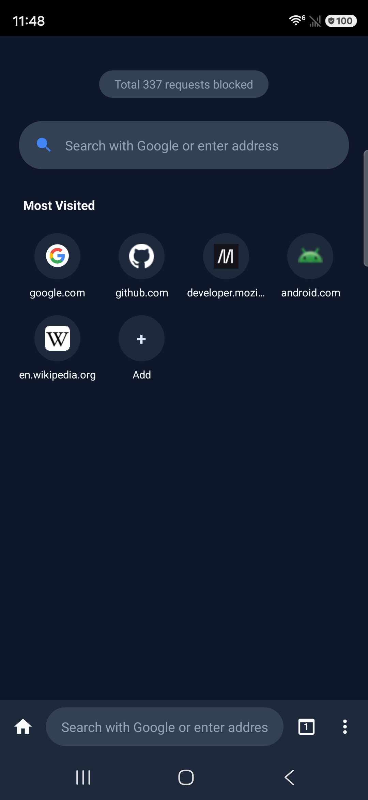
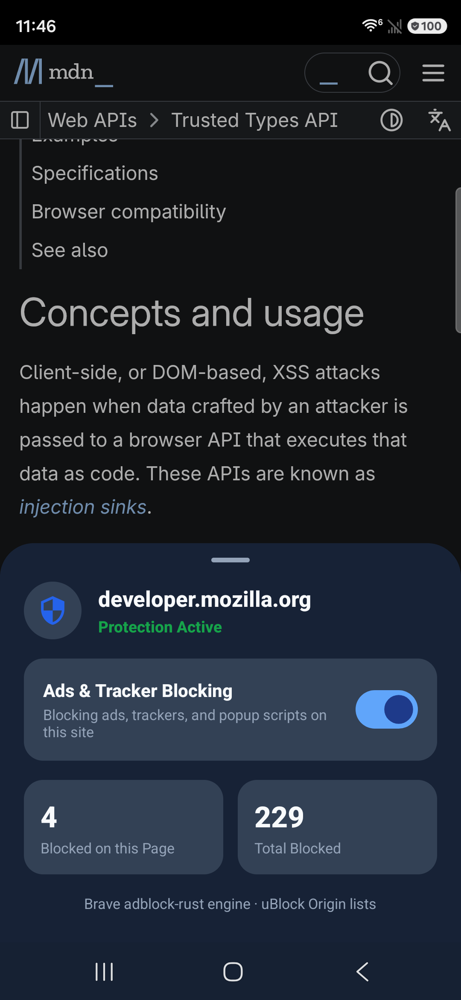
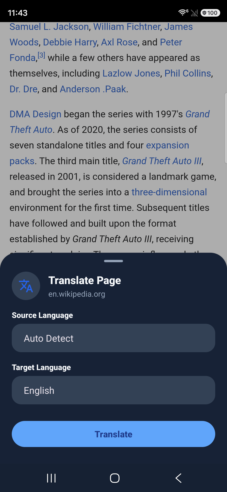

# 🚀 Orbit Browser

**A high-performance, ultra-lightweight Android web browser built on Android System WebView, featuring an embedded Brave `adblock-rust` C++/Rust engine, uBlock Origin filter lists, multi-language page translation, and Material Design 3 UI.**

Designed to run smoothly on devices with 1 GB RAM and fully compatible with newer Android versions.

---

## 📸 Screenshots

| Start page | Shield | Translate |
| :---: | :---: | :---: |
|  |  |  |
| Most Visited tiles carry each site's favicon, and the **Add** tile lets you pin your own shortcuts. The pill above shows how many requests have been blocked so far. | Per-site protection toggle, with counts for the current page and for the lifetime of the install, served by the Brave `adblock-rust` engine. | Source language is auto-detected and the target language is yours to pick; the page keeps its layout and links. |

---

## 🆕 What's new in 2.5

- **Background audio** — radio and video keep playing when you leave Orbit. A small
  notification with Play / Pause / Stop keeps the process alive, and lock-screen and
  headset buttons work through a `MediaSession`. It only appears when a page is really
  playing audible sound.
- **Editable start page** — the Most Visited grid is yours: add your own shortcuts,
  edit or remove them, and remove ones that came from history without touching your
  history. Tiles now show each site's favicon.
- **Tablets, foldables and landscape** — the address bar can sit at the top or the
  bottom (Settings → Appearance), the shortcut grid widens to 6 or 8 columns, touch
  targets grow on wide screens, and bottom sheets open fully expanded.
- **Print page** — print or save the current page as a PDF from the menu, through the
  system print dialog.
- **30 filter lists** — the catalog doubled with AdGuard Base, Tracking, Mobile,
  Annoyances and Social, plus per-language lists for German, French,
  Spanish/Portuguese, Japanese, Dutch, Italian, Chinese, Polish, Indonesian and Korean.
- **Old Samsung devices** — the About screen no longer crashes on Android 6, legacy PNG
  launcher icons were added for API < 26, and new tabs no longer show the previous
  tab's URL.
- **Dark theme fixes** — sheets, dialogs and the About screen were painted stock
  Material black instead of Orbit's navy, and pages that do not paint their own
  background rendered black text on a dark base. Both are fixed.
- **Performance** — address bar suggestions are debounced and no longer queue behind
  the network, history writes use SQLite WAL, favicons are saved off the main thread,
  and the request path parses each URL once.

Full changelog, in Russian and English: [CHANGES.md](CHANGES.md) —
[releases](https://github.com/egeeuzun/orbit/releases).

---

## ✨ Features

### 🛡️ 1. Ad Blocking
- **Embedded C++/Rust JNI Engine:** Powered by Brave Software's `adblock-rust` crate executing directly at native speed.
- **30 Filter Lists:** uBlock Origin core, badware and privacy lists, EasyList and EasyPrivacy, AdGuard Base, Tracking, Mobile, Annoyances and Social, Fanboy's lists, cookie-notice lists, and per-language lists for Turkish, Russian, German, French, Spanish/Portuguese, Japanese, Dutch, Italian, Chinese, Polish, Indonesian and Korean. The global core plus Turkish and Russian are enabled by default; the rest are one tap away in Settings.
- **Cosmetic Filtering:** Ad slots that survive network blocking are hidden by a document-start script, with optional generic filters.
- **Live Blocking Stats:** The Shield item in the menu opens a bottom sheet showing blocked counts for the current page and for the lifetime of the install.
- **Per-Site Protection Toggle:** Easily toggle adblocking ON/OFF for any website with a single tap (per-site allowlist).
- **Popup Blocking:** `window.open` calls to domains the engine flags as popups are consumed instead of opening a window, with a short toast in their place.

### 🌐 2. Multi-Language Web Page Translation
- **Flexible Source & Target Languages:** Tap "Translate Page" from the overflow menu to translate any webpage.
- **Auto-Detection & System Locale Matching:** Source language is auto-detected; target language defaults to system language (supports English, Turkish, German, French, Spanish, Russian, Arabic, Japanese, Chinese, Korean, Hindi, etc.) while keeping the webpage layout and links intact.

### 🏠 3. Editable Start Page
- **Most Visited grid** built from your history, with each site's favicon on the tile.
- **Your own shortcuts:** the "+ Add" tile opens a small form (name optional, address required); long-press a shortcut you added to edit or remove it.
- **Remove what you do not want:** long-press a shortcut that came from history to drop it from the grid. Your history is kept and the site stays gone even after you visit it again.
- **Reset home shortcuts** in Settings → Appearance brings everything back.
- The grid widens with the screen: 4 columns on phones, 6 on wide screens, 8 on large tablets.

### 📐 4. Phone, Tablet, Foldable and Landscape Layouts
- **Address bar position** is a setting: Automatic (top on tablets, bottom on phones), Always top, or Always bottom.
- Touch targets, address bar height and text size grow on wide screens.
- Bottom sheets open fully expanded instead of a short peek you have to drag open.
- Edge-to-edge layout with proper insets for the status bar, camera cutout, navigation bar and keyboard; insets are frozen during fullscreen video so the page does not jump.

### 🔊 5. Background Media Playback
- Radio and video **keep playing when you leave the browser**.
- A foreground notification with **Play / Pause / Stop** keeps the process alive, and a `MediaSession` wires up lock-screen controls plus headset and Bluetooth buttons.
- The notification only appears when a page is actually playing audible sound, and Stop really stops playback.

### 🔍 6. Dynamic Search Engine & Real-Time Suggestions
- Google is set as default (switchable to DuckDuckGo, Bing, Yandex, Brave, Startpage).
- Dynamic search bar hint automatically updates to reflect the chosen engine (*"Search with Google or type URL"*).
- Optional real-time OpenSearch autocompletion in Settings; local history results appear immediately while online suggestions arrive separately.

### 🌙 7. Full Material 3 Light/Dark Theme & Web Darkening
- Complete Material Design 3 Day/Night theme with synchronized status bar and navigation bar icon colors, applied consistently to sheets, dialogs and every screen.
- **Independent Web Darkening:** Web pages are NOT forcibly darkened just because Dark Theme is on. Web darkening ("Darken sites") is an independent option in Settings > Appearance, and pages keep a white base until you turn it on.

### 🖨️ 8. Printing
- Print the current page or save it as a PDF from the overflow menu, through the system print dialog.

### 📌 9. Optional Tab Session Restore
- *"Restore open tabs"* setting under Settings > General automatically restores tabs and URLs when reopening the app (Disabled by default).

### 📱 10. Webapp Mode & Home-Screen Shortcuts
- Pin any site to the home screen through the system dialog (`requestPinShortcut`); the shortcut icon is the site favicon, cached per host.
- The site opens as a fullscreen window with no address bar or toolbars, in its own task, so it multitasks as a separate app. Re-tapping the shortcut returns to the same window.
- Ad blocking, popup blocking and downloads all work inside a webapp window.

### ⬇️ 11. Downloads
- Files go through the system DownloadManager into the Downloads folder, with a progress notification, in both the browser and webapp mode.
- Handles APK links served without a `Content-Disposition` header.

---

## ⚡ Memory & Performance

Measured on a 1 GB-class Android phone, release build:

| State | RAM |
| :--- | ---: |
| Start page, idle | ~30 MB |
| One page open | ~65–90 MB |
| Three tabs open | ~180 MB |

Cold start takes well under a second. Memory runs higher for a few seconds right after
launch while the filter engine is built, then settles.

- **Single Live WebView Architecture:** Only one WebView is kept alive by default.
  Background tabs are serialized with `saveState()` and their WebView destroyed, so the
  renderer memory comes back; they are restored when selected.
- **Compiled Engine Binary (`engine.bin`):** Filter rules are compiled once into a
  binary cache, so cold start does not pay for parsing them again.
- **Host Fast Path (`hosts.bin`):** A sorted host table answers most block decisions
  without crossing into the engine, and it is ready long before the full engine is.
- **Off-Main-Thread Everything:** SQLite, WebView provider warm-up, favicon writes and
  search suggestions all run off the main thread.
- **Memory Pressure Handling:** When the system asks for memory, background tabs are put
  to sleep and the ad blocker's decision cache is released.

---

## 🤝 Contributors

- [@timcho968](https://github.com/timcho968) — webapp mode, downloads, popup blocking, Russian
  filter lists, the Jelly-style interface, and the privacy and signing work that went into 2.0.0
  ([#2](https://github.com/egeeuzun/orbit/pull/2)).

Bug reports and pull requests are welcome.

---

## 📜 Licenses & Open Source

Orbit Browser is open-source software distributed under the terms of the **Mozilla Public License 2.0 (MPL 2.0)**.

### Open Source Libraries & Components:
- **Orbit Browser:** Mozilla Public License 2.0 (MPL 2.0)
- **Brave adblock-rust Engine:** Mozilla Public License 2.0 (MPL 2.0) — Native C++/Rust adblock JNI engine by Brave Software.
- **uBlock Origin Filter Lists:** GNU General Public License v3.0 (GPLv3) — Community filter lists by Raymond Hill (gorhill) & contributors.
- **AndroidX & Jetpack Libraries:** Apache License 2.0 — Core-KTX, AppCompat, RecyclerView, WebKit, Lifecycle.
- **Google Material Components:** Apache License 2.0 — Material Design 3 UI components & BottomSheet dialogs.
- **Kotlin Standard Library:** Apache License 2.0 — Language runtime & tools by JetBrains.

---

## 🛠 Building & Running

Clone the repository and build using Android Studio or terminal:

```bash
./gradlew assembleRelease
```

To re-compile the native `.so` adblock JNI engine from Rust sources (optional):

```bash
rustup target add aarch64-linux-android armv7-linux-androideabi x86_64-linux-android
cargo install cargo-ndk
export ANDROID_NDK_HOME=$ANDROID_HOME/ndk/27.2.12479018
./gradlew buildNativeAdblock
```

---

## 📁 Project Structure

```
app/src/main/
  java/com/orbit/browser/
    adblock/     AdblockService (downloading, compilation, decision cache), filter list
                 catalog, host blocklist, JNI wrapper (NativeAdblock)
    browser/     OrbitWebView (touch focus & scroll listener), WebView clients, tab
                 management, DownloadHelper, FaviconStore, cosmetic filtering bridge
    data/        Preferences (Prefs), Search Suggestions, SQLite DB, browsing data
    ui/          MainActivity, WebappActivity, SettingsActivity, ShieldSheet, MenuSheet,
                 TabsSheet, TranslateSheet, HomeView, ListActivity, AboutActivity
    util/        URL helpers
  res/
    layout/      activity_main.xml, activity_settings.xml, activity_list.xml,
                 dialog_shield.xml, dialog_translate.xml, view_home.xml
    values/      strings.xml (English default), themes.xml, colors.xml
    values-night/ dark palette (colors.xml, bools.xml)
    values-tr/   strings.xml (Turkish)
rust/adblock-jni/ JNI bridge for Brave adblock-rust engine
```
